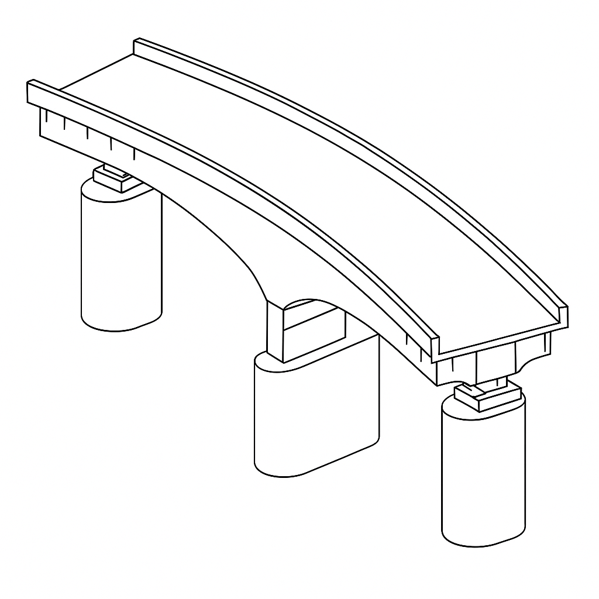
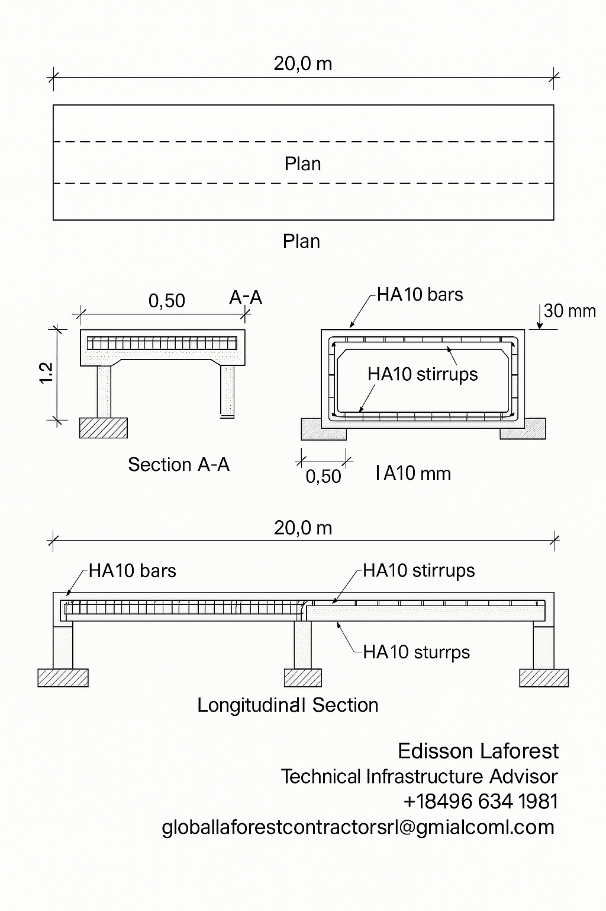
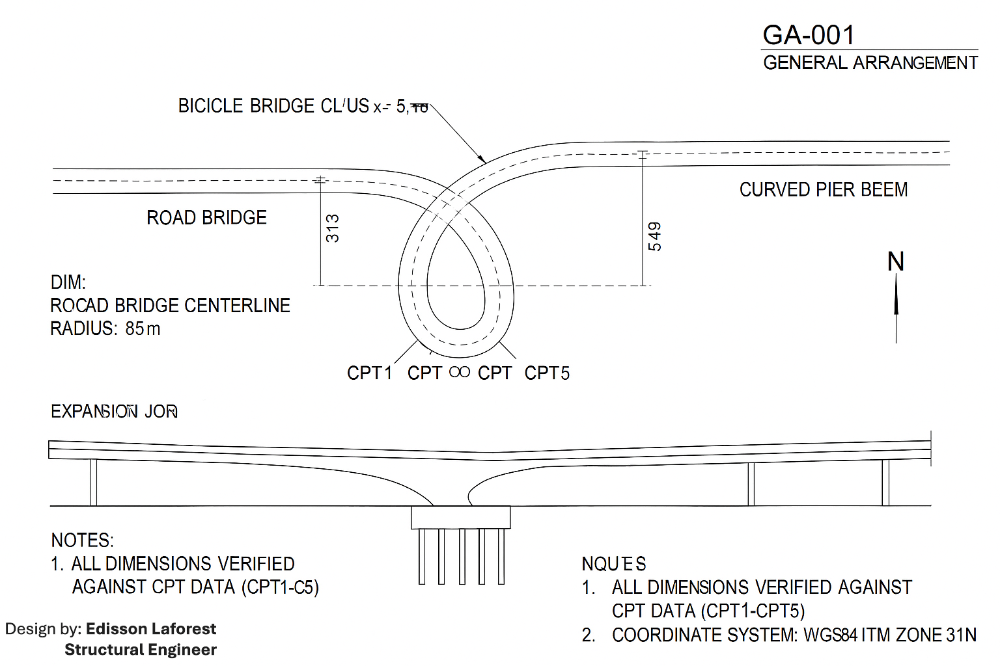

# 🌉 Bridge Engineering

## Structural Design & Engineering Documentation

This portfolio section presents selected bridge engineering work focused on structural layout, reinforced-concrete components, structural detailing, constructability, and engineering documentation.

The examples demonstrate the application of structural engineering principles to bridge systems, including superstructure components, curved structural members, pile-cap systems, reinforcement detailing, and general arrangement drawings.

---

## 📐 Engineering Scope

Selected engineering activities represented in this portfolio include:

- Structural system development
- Bridge structural layout
- Reinforced-concrete member detailing
- Curved beam structural configuration
- Pile and pile-cap detailing
- Beam-to-pile-cap connection development
- Reinforcement detailing
- General arrangement drawings
- Structural constructability considerations
- Technical engineering documentation

---

## 🏗️ Structural Components

The portfolio examples include engineering documentation related to:

### Bridge Superstructure

- Bridge structural configuration
- Curved beam systems
- Structural framing
- General arrangement
- Structural member detailing

### Substructure

- Reinforced-concrete pile caps
- Pile positioning
- Beam-to-pile-cap connections
- Reinforcement detailing
- Foundation-related structural components

---

## 🖼️ Selected Engineering Work

### 1. Bridge 3D Structural View

A three-dimensional representation of the bridge structural configuration.

---

### 2. Bridge Structural Design

Selected structural design documentation illustrating the bridge structural system and engineering development.

---

### 3. Engineering Drawing

Technical engineering drawing illustrating bridge geometry and structural arrangement.

---

## 🧱 Foundation & Connection Engineering

Bridge foundation components require careful consideration of load transfer between the superstructure, substructure, pile caps, and piles.

Selected portfolio work includes:

- Pile-cap configuration
- Pile positioning
- Reinforced-concrete beam connections
- Reinforcement arrangement
- Structural connection detailing
- Constructability considerations

---

## 💻 Engineering Tools

The bridge engineering workflow may incorporate:

| Tool | Application |
|---|---|
| **SAP2000** | Structural modeling and analysis |
| **AutoCAD** | Engineering drawings and detailing |
| **Python** | Engineering automation and data processing |

---

## 📚 Engineering Standards

Depending on project requirements, bridge engineering work may be developed with reference to:

- **AASHTO LRFD**
- **ACI 318**
- **ASCE standards**
- Applicable project specifications and local requirements

---

## 🎯 Engineering Focus

My approach to bridge engineering combines:

**Structural Safety → Load Path → Analysis → Design → Detailing → Constructability**

The objective is not only to produce technically correct calculations, but to develop structural solutions that can be clearly understood, constructed, inspected, and maintained.

---

## 👷 Professional Contribution

My engineering work focuses on transforming structural concepts into practical engineering deliverables, including structural layouts, analysis models, reinforced-concrete detailing, connection development, and technical documentation.

Where project confidentiality applies, identifying information and proprietary project documentation are intentionally excluded from this portfolio.

---

## 📌 Portfolio Note

The images presented here are selected engineering examples intended to demonstrate technical capability and engineering methodology. They should not be interpreted as complete construction documentation unless explicitly identified as such.

---

[← Back to Portfolio](../../README.md)